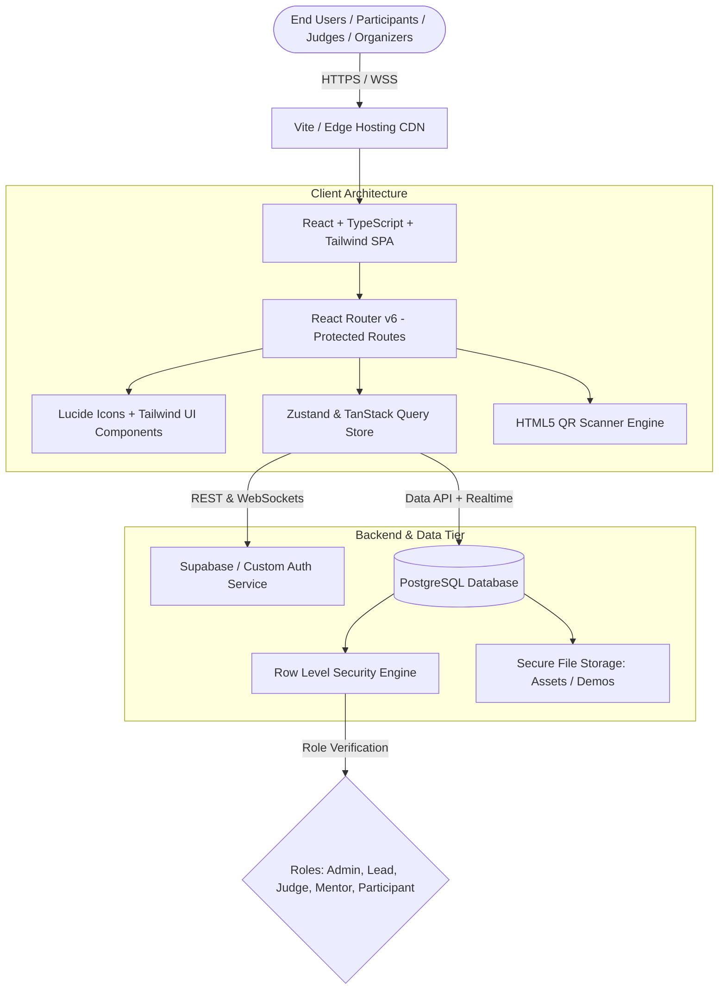
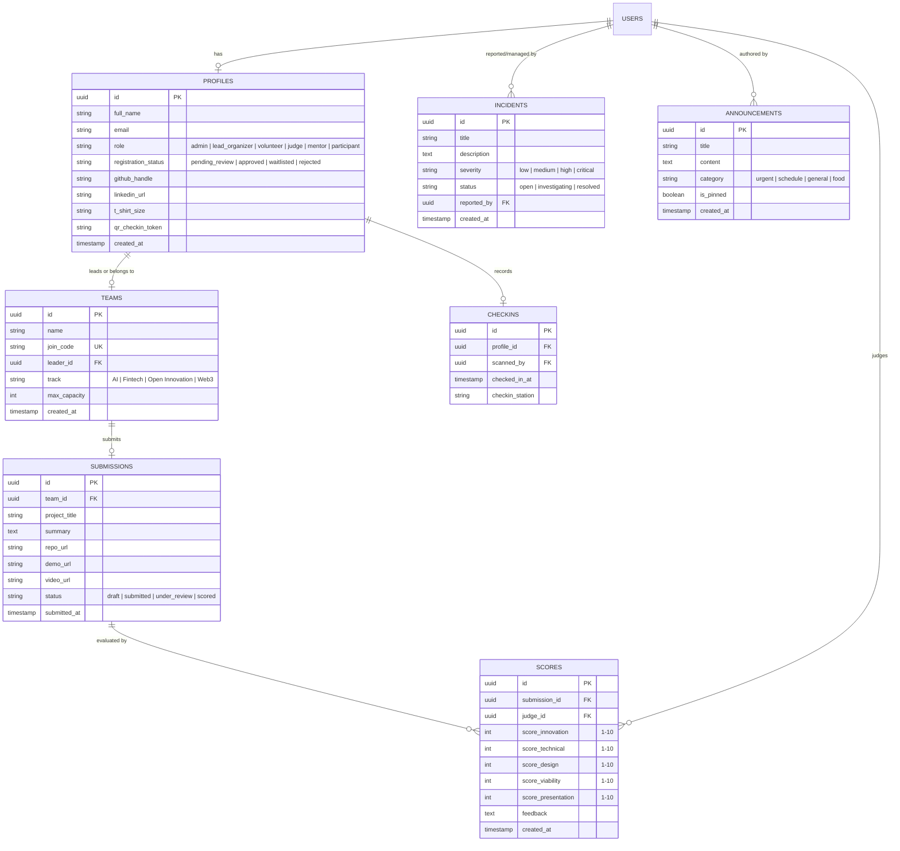

# VERTOTHON 2026 — System Architecture Specification

> **Target Platform:** VERTOTHON 2026 Operations Platform  
> **Engineering Scope:** Scalable Prototype up to 1,000 Concurrent Participants  
> **Architecture Pattern:** Decoupled Modular SPA + BaaS / Serverless PostgreSQL with Row Level Security (RLS)  

---

## 1. High-Level Architecture Overview



---

## 2. Technology Stack Selection & Rationale

| Layer | Selected Technology | Technical Rationale |
|---|---|---|
| **Build & Tooling** | **Vite + TypeScript 5.x** | Instant HMR (<50ms), native ES modules, strict type safety across data schemas and API contracts. |
| **Frontend Framework** | **React 18 / 19** | Industry-standard declarative component architecture, unmatched ecosystem support for tables, charts, and form controls. |
| **Styling & Design System** | **Tailwind CSS + Lucide Icons** | Utility-first CSS providing atomic styling, responsive breakpoints, high-contrast accessible dark/light modes, zero runtime overhead. |
| **State & Server Cache** | **TanStack Query (React Query) + Zustand** | Optimistic UI updates, automated background polling/refetching for live Control Room stats, clean lightweight client store. |
| **Database & Auth** | **PostgreSQL + Supabase / Neon** | Relational integrity, relational foreign keys, SQL migration safety, built-in Row Level Security (RLS), real-time broadcast capabilities. |
| **QR Engine** | **html5-qrcode & qrcode.react** | Pure client-side zero-latency QR code generation and high-speed in-browser camera scanning without external hardware. |
| **Validation & Schema** | **Zod + React Hook Form** | Type-safe form validation, zero runtime crash risks from malformed user submissions. |
| **Testing Suite** | **Vitest + React Testing Library** | Lightning-fast test runner native to Vite with DOM testing compatibility. |

---

## 3. Database Entity Relationship Model (ERD)

The database schema is structured to cleanly separate authentication, profiles, team dynamics, control room incidents, attendance, and judging.



---

## 4. Security & Role-Based Access Control (RBAC)

### User Roles Hierarchy
1.  **Platform Admin / Lead Organizer (`admin`, `lead_organizer`):**
    *   Full read/write permissions on all entities.
    *   Approve/reject applicants, assign tracks, reassign teams.
    *   Post system announcements and broadcast incident resolutions.
    *   Finalize and approve judging results.
2.  **Volunteer Desk (`volunteer`):**
    *   Access to the Check-In scanning module.
    *   Verify attendee identity and generate check-in receipts.
    *   Read-only access to attendee directory.
3.  **Judge (`judge`):**
    *   Read access to assigned team project submissions.
    *   Write access only to their own submitted scorecards (`SCORES`).
    *   Zero visibility into other judges' scores until unmasked by the lead organizer.
4.  **Mentor (`mentor`):**
    *   View active mentoring requests submitted by teams.
    *   Claim and resolve tickets.
5.  **Participant (`participant`):**
    *   View public announcements and personal profile.
    *   Create or join exactly one team.
    *   Team leader can create and update the team's project submission before deadline.
    *   Cannot view other teams' draft submissions or raw judge scores.

### Row Level Security (RLS) Policies
*   `PROFILES`: `SELECT` allowed for all authenticated users; `UPDATE` allowed only if `auth.uid() = id` OR user is `admin`.
*   `TEAMS`: `SELECT` public; `INSERT` allowed for approved participants; `UPDATE` allowed for team leader or `admin`.
*   `SUBMISSIONS`: `SELECT` allowed for team members, judges, and admins; `INSERT/UPDATE` allowed only for team leader before event submission cutoff.
*   `SCORES`: `SELECT` allowed for respective judge and admin; `INSERT/UPDATE` allowed only for assigned judge.

---

## 5. Capacity & Scalability Design (1,000 Participants)

*   **Static Asset Delivery:** All frontend assets bundle into gzip/brotli static bundles delivered via global CDN edge.
*   **Database Connection Pooling:** PgBouncer transaction pooling enabled to handle sudden spikes during morning check-in and 11th-hour project submissions.
*   **Offline-Tolerant Check-in:** Volunteer QR scanner checks a local client-side memory cache of approved participant hashes to ensure check-in works even if onsite venue Wi-Fi stutters.
*   **Debounced Auto-Save:** Submission drafts implement a 2-second debounced local/remote autosave to prevent request storms.

---

## 6. Proposed Directory Structure

```text
vertothon-2026/
├── .github/
│   └── workflows/
│       └── ci.yml                 # Automated linting, typechecking, and tests
├── src/
│   ├── assets/                    # SVG logos, Vertofi branding assets
│   ├── components/
│   │   ├── common/                # Buttons, Modal, Badge, Card, Toast, Table
│   │   ├── layout/                # Navbar, Sidebar, Footer, PageHeader
│   │   ├── control-room/          # MetricsCard, IncidentFeed, BroadcastModal
│   │   ├── checkin/               # QRScanner, CheckinBadge, AttendeeLookup
│   │   ├── teams/                 # TeamCard, MemberList, InviteModal
│   │   └── judging/               # ScorecardForm, SubmissionReview, Leaderboard
│   ├── context/                   # AuthContext, NotificationContext
│   ├── hooks/                     # useAuth, useTeams, useSubmissions, useScanner
│   ├── lib/                       # Supabase client, query client, formatting helpers
│   ├── pages/
│   │   ├── public/                # LandingPage, RulesPage, SchedulePage
│   │   ├── auth/                  # LoginPage, RegisterPage, ForgotPassword
│   │   ├── dashboard/             # ParticipantDashboard, TeamManagement
│   │   ├── control-room/          # ControlRoomPage, AttendeesPage, IncidentsPage
│   │   ├── checkin/               # CheckinDeskPage
│   │   └── judging/               # JudgePortalPage, ResultApprovalPage
│   ├── services/                  # API abstraction layer (mock & supabase)
│   ├── types/                     # TypeScript entity and database definitions
│   ├── utils/                     # QR encoding, date calculations, validation
│   ├── App.tsx                    # Route definitions
│   └── main.tsx                   # React root entrypoint
├── tests/
│   ├── unit/                      # Component & hook tests
│   └── e2e/                       # Critical flow specs (registration, check-in)
├── .env.example
├── .gitignore
├── index.html
├── package.json
├── tailwind.config.js
├── tsconfig.json
└── vite.config.ts
```

---

## 7. Shared UI Component Library (`src/components/common/`)

The platform includes a zero-external-dependency atomic UI library built with Tailwind CSS and React:

### Available Components & Usage

#### 1. `Button`
Supports variants (`primary`, `secondary`, `outline`, `danger`), sizes (`sm`, `md`, `lg`), left/right icons, and accessible loading state (`isLoading`).
```tsx
import { Button } from '@/components/common';
import { ArrowRight } from 'lucide-react';

<Button variant="primary" size="md" rightIcon={<ArrowRight className="w-4 h-4" />}>
  Submit Entry
</Button>
<Button variant="secondary" isLoading={isSubmitting}>
  Saving
</Button>
```

#### 2. `Badge`
Status pills for review, role, and track indicators (`neutral`, `success`, `warning`, `danger`, `info`) with optional dot indicator.
```tsx
import { Badge } from '@/components/common';

<Badge variant="success" dot>Approved</Badge>
<Badge variant="warning">Waitlisted</Badge>
```

#### 3. `Modal`
Accessible dialog with backdrop blur, `Escape` key listeners, scroll-locking, and action handlers.
```tsx
import { Modal } from '@/components/common';

<Modal
  isOpen={isOpen}
  onClose={() => setIsOpen(false)}
  onConfirm={handleConfirm}
  title="Lock Submission"
  confirmLabel="Lock"
>
  <p>Submission will be finalized.</p>
</Modal>
```

#### 4. `Toast`
Notification banner for feedback (`success`, `error`, `warning`, `info`) with automatic timeout and manual dismiss.
```tsx
import { Toast } from '@/components/common';

<Toast
  toast={{ id: '1', type: 'success', title: 'Saved', duration: 4000 }}
  onDismiss={handleDismiss}
/>
```

#### 5. `SelectDropdown`
Accessible, labeled `<select>` element with error states, helper texts, and custom styling.
```tsx
import { SelectDropdown } from '@/components/common';

<SelectDropdown
  label="Track"
  value={track}
  onChange={setTrack}
  options={[{ value: 'ai', label: 'AI' }, { value: 'fintech', label: 'Fintech' }]}
/>
```

#### 6. `DataTable<T>`
Generic typed table component with column definitions, loading spinners, and customizable empty states.
```tsx
import { DataTable, ColumnDef } from '@/components/common';

const columns: ColumnDef<Participant>[] = [
  { key: 'name', header: 'Name' },
  { key: 'role', header: 'Role', render: (row) => <Badge>{row.role}</Badge> },
];

<DataTable columns={columns} data={participants} keyExtractor={(p) => p.id} />
```

---

## 8. Database Migrations & Row Level Security (RLS)

All database schema evolutions are version-controlled under `supabase/migrations/`.

### Migration: `20261012000000_initial_schema.sql`

#### Core Entities Created:
1. **`profiles`**: Linked 1:1 with `auth.users(id)` with automatic registration trigger (`on_auth_user_created`). Stores role (`user_role`), review status (`registration_status`), QR tokens, and contact metadata.
2. **`teams`**: Stores team names, join codes, leader references, and tracks (`AI`, `Fintech`, etc.).
3. **`team_members`**: Junction table enforcing that a participant belongs to at most one team (`UNIQUE (profile_id)`) and team size does not exceed `max_capacity`.
4. **`submissions`**: Team project repository links, demo URLs, track selections, and status flags.
5. **`incidents`**: Operational control room incident log with severity and status.
6. **`announcements`**: Public broadcast ticker.

#### Security & Access Control Policies:
* **Privilege Escalation Prevention:**
  * When users update their own profile, a `WITH CHECK` clause ensures they cannot alter their assigned `role` or `registration_status`.
  * Trigger `handle_new_user()` strictly initializes new accounts with `role = 'participant'`.
* **Security-Definer Helper Functions:**
  * Functions `is_admin_or_organizer()`, `is_staff()`, `is_team_member()`, and `is_team_leader()` run with strict `SET search_path = public, auth` to prevent search path hijacking.
* **Table RLS Status:** Enabled on all 6 tables. Anonymous access is strictly limited to viewing `announcements`.
