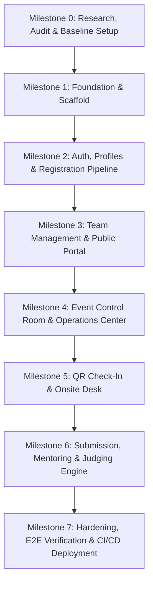

# VERTOTHON 2026 — Implementation Plan

> **Strategy:** Phased, Test-Driven Prototype Development  
> **Target Scale:** 1,000 Participants  
> **Key Guardrail:** Payment gateways disabled; features verified in staged milestones.  

---

## 1. Milestones & Implementation Roadmap

---

## 2. Milestone Breakdown

### Milestone 0: Research, Audit, and Baseline (Current Phase)
*   **Deliverables:**
    *   Verify empty repository state and initialize clean git branch `main`.
    *   Investigate Vertofi and VERTOTHON 2026 public data.
    *   Produce the 5 baseline documents (`REQUIREMENTS_BASELINE.md`, `REPOSITORY_AUDIT.md`, `ARCHITECTURE.md`, `IMPLEMENTATION_PLAN.md`, `IMPLEMENTATION_CHECKLIST.md`) and `.env.example`.
    *   Connect remote origin and establish clean initial commit history.
*   **Acceptance Criteria:**
    *   [x] All 5 core planning documents present and populated.
    *   [x] Repository git remote set to `https://github.com/bharathwajverse/vertothon-2026.git`.
    *   [x] Zero application code broken or unapproved changes committed.

---

### Milestone 1: Foundation & Project Scaffold (Next Immediate Step)
*   **Scope:**
    *   Initialize Vite + React 18+ + TypeScript template.
    *   Configure Tailwind CSS, PostCSS, and Lucide React icons.
    *   Setup Vitest and React Testing Library test harness.
    *   Configure routing (`react-router-dom`) with layout scaffolds (Navbar, Sidebar, Footer).
    *   Create Mock Service Worker / Mock Data Layer for standalone offline development.
*   **Verification:**
    *   `npm run build` exits 0.
    *   `npm run test` executes base smoke test with 100% pass rate.
    *   `npm run dev` serves landing page on `http://localhost:5173`.

---

### Milestone 2: Authentication & Registration Workflow
*   **Scope:**
    *   Implement user registration, login, and password reset screens.
    *   Role-Based Access Control (RBAC) middleware / route guard (`admin`, `volunteer`, `judge`, `mentor`, `participant`).
    *   Participant registration intake form with profile data, tech stack, and dietary preferences.
    *   Status workflow: `pending_review` $\to$ `approved` | `waitlisted` | `rejected`.
*   **Verification:**
    *   Unit test validating registration status transitions.
    *   Unauthorized users redirected from protected paths.

---

### Milestone 3: Team Formation & Public Event Portal
*   **Scope:**
    *   Public homepage featuring Vertofi branding, countdown timer, schedule, and track overviews.
    *   Team creation with auto-generated 6-character alphanumeric join code.
    *   Join team flow with real-time membership limit enforcement (1–4 members).
    *   Team leader administrative actions (transfer ownership, remove member).
*   **Verification:**
    *   Attempting to join a full team rejects with descriptive validation message.
    *   Leader permissions restricted to team owner.

---

### Milestone 4: Event Control Room (Command Center)
*   **Scope:**
    *   Live Operations Dashboard for organizers.
    *   KPI cards: Total Registered, Approval Rate, Check-in Percentage, Formed Teams, Submissions.
    *   Master participant table with search, role filters, status switches, and CSV export.
    *   Broadcast announcement publisher (Urgent / Schedule / General).
    *   Operational Incident Logger (Low, Medium, High, Critical).
*   **Verification:**
    *   KPI aggregation reacts in real-time to simulated state changes.
    *   Incident status can be updated from `open` to `investigating` and `resolved`.

---

### Milestone 5: Attendance & QR Check-in Desk
*   **Scope:**
    *   Generate secure QR check-in token for each approved attendee.
    *   Mobile/desktop responsive camera scanner using `html5-qrcode`.
    *   Instant attendee profile display upon scan with "Check-In" button.
    *   Duplicate check-in prevention warning with timestamp of previous entry.
*   **Verification:**
    *   Scanning a valid QR code marks attendee as `checked_in`.
    *   Scanning the same QR code twice triggers an immediate warning toast.

---

### Milestone 6: Submissions, Mentoring & Judging Engine
*   **Scope:**
    *   Team submission portal (GitHub repo, demo video, live link, project overview).
    *   Hard deadline cutoff countdown with form lock.
    *   Mentor Help Desk ticketing system.
    *   Judge evaluation portal: assigned teams, 5-criterion rubric scoring (1–10).
    *   Result Approval screen: weighted score normalization, ranking table, organizer approval trigger.
*   **Verification:**
    *   Submissions past deadline disallow edits.
    *   Scorecard calculation unit tests match mathematical specification.

---

### Milestone 7: Hardening, Performance & CI/CD Deployment
*   **Scope:**
    *   Lighthouse audit optimization (>90 across Performance, Accessibility, Best Practices).
    *   GitHub Actions CI workflow for automated lint, typecheck, and unit test execution on pull request.
    *   Production build artifact verification.
*   **Verification:**
    *   Clean CI run across all test suites.

---

## 3. Risk Management & Contingency Matrix

| Risk Scenario | Probability | Impact | Mitigation Strategy |
|---|---|---|---|
| **Venue Wi-Fi instability during check-in** | High | Critical | Client-side memory cache of approved participant hashes; offline sync capability. |
| **Submission rush at deadline** | High | High | Auto-save debouncing; client-side file hosting directly to cloud storage; CDN caching. |
| **Unapproved pricing policy changes** | Low | High | Hardcoded feature flag `VITE_FEATURE_PAYMENTS_ENABLED=false` until explicit organizer sign-off. |
| **Score tampering / leakage** | Medium | Critical | PostgreSQL Row Level Security prevents participants and unauthorized judges from reading score records. |
