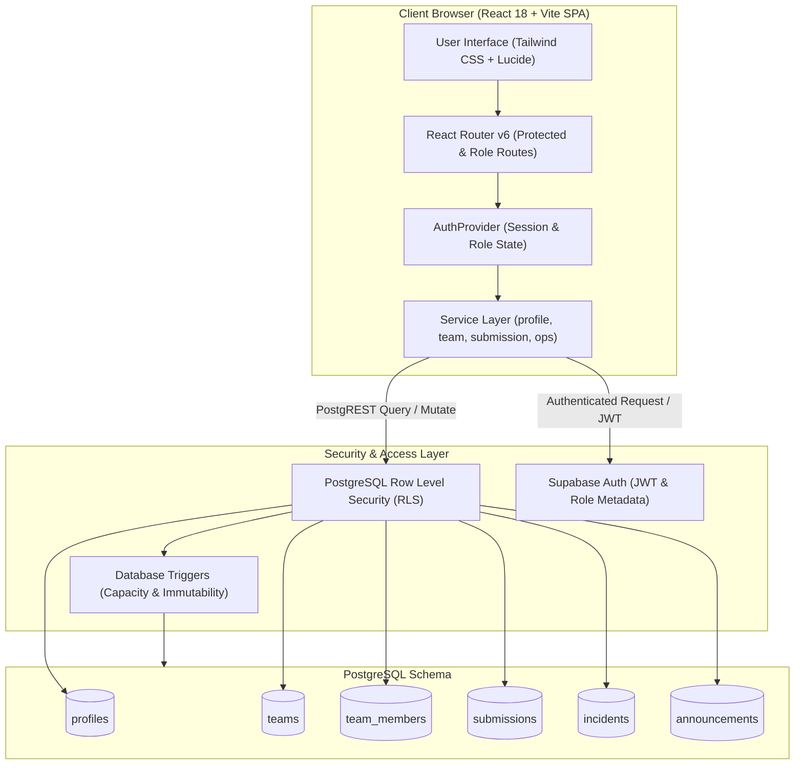
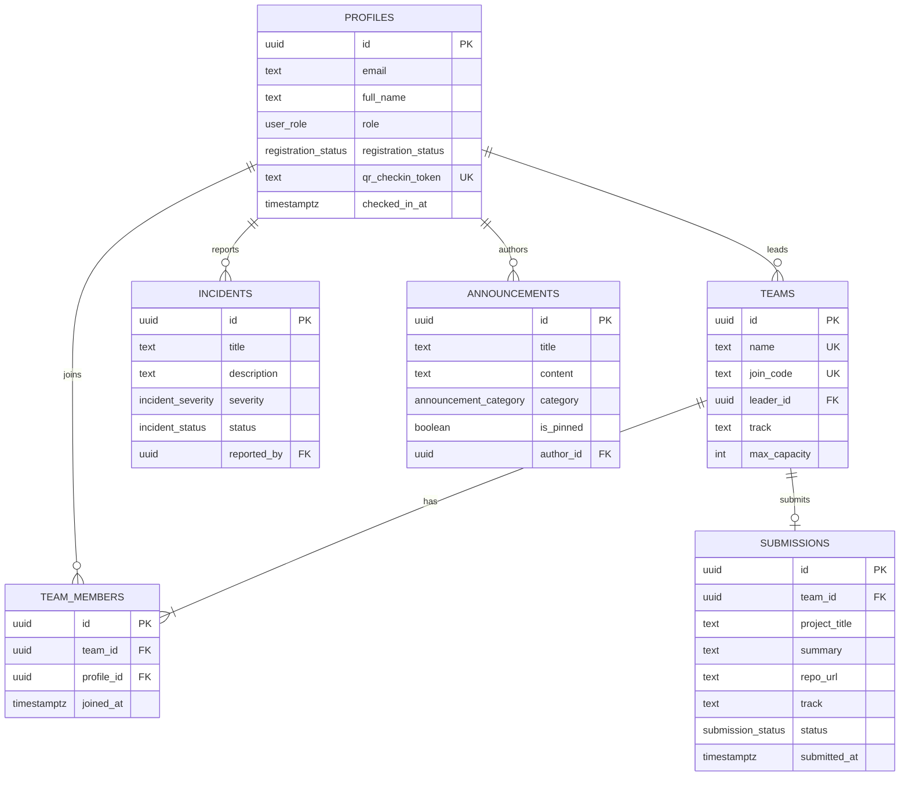

# VERTOTHON 2026

A scalable hackathon event management platform for participant registration, team coordination, event operations, and organizer administration.

[](./LICENSE)
[](https://www.typescriptlang.org/)
[](./src/test)
[](./.eslintrc.cjs)

---

## Overview

Hackathons involve rapid coordination across distinct stakeholder groups under tight deadlines. Managing registrations in spreadsheets, manually verifying badge check-ins at entry doors, coordinating team formation across chat apps, and collecting late project submissions frequently cause bottlenecks during 24- to 36-hour offline events.

**VERTOTHON 2026** is a dedicated hackathon operations platform designed to centralize and automate event administration. It unifies attendee onboarding, role-based access control, team formation, physical check-in desks, incident response, project deliverable intake, and rubric-based judging into a single responsive web interface backed by a relational database with strict row-level security.

### Target Personas

* **Participants:** Register with professional profiles, discover teammates, create or join teams using 6-character codes, track schedule timelines, and submit project links and deliverables.
* **Organizers & Leads:** Review and approve attendee registrations, monitor live event telemetry, broadcast urgent announcements, track physical check-in ratios, and export attendee audit rosters to CSV.
* **Volunteers & Operations Desk:** Scan and verify participant check-in QR tokens at venue entrance desks, log facilities or technical incidents, and prevent duplicate door entries.
* **Mentors:** Review project tracks and guide registered teams through scheduled architecture checkpoints.
* **Judges:** Evaluate finalized submissions across standardized 4-dimension rubrics with input validation, private scoring, and live score averaging.

---

## Key Features

### 1. Registration & Authentication
* **Role-Based Access Control (RBAC):** Built-in support for 6 roles: `participant`, `lead_organizer`, `volunteer`, `judge`, `mentor`, and `admin`.
* **Profile Intake:** Collects attendee credentials, GitHub handle, LinkedIn URL, academic or corporate affiliation, t-shirt size, and dietary restrictions.
* **Application Status Workflow:** Participant registration tracks 4 explicit states (`pending_review`, `approved`, `waitlisted`, and `rejected`).
* **Session Persistence:** Persistent auth state via Supabase Auth with client-side mock fallback when offline or in standalone demonstration mode.

### 2. Team Formation & Management
* **6-Character Join Codes:** Team leaders generate alphanumeric invitation codes for secure roster joining.
* **Track Selection:** Teams register under 5 hackathon tracks: AI, Web3, FinTech, HealthTech, and Open Innovation.
* **Capacity Limit Enforcement:** Hard maximum of 4 members per team enforced both at the UI layer and via PostgreSQL database triggers (`trg_check_team_capacity`).
* **Roster Self-Service:** Team leaders can remove members or disband teams; members can depart teams independently prior to code freeze.

### 3. Command Center & Telemetry
* **Real-Time Key Metrics:** Live count of total registrations, approved attendees, formed teams, and submitted projects.
* **Database Connection Health:** Dynamic health checks reporting Supabase connection latency, table reachability, and RLS validation.
* **Data Export:** Single-click CSV export of participant rosters for offline registration badges, security, and venue logistics.
* **Prototype Fallback Mode:** Seamlessly falls back to simulated prototype benchmark metrics if backend credentials are unset or unreachable.

### 4. Operations & Door Check-In Desk
* **QR / Token Verification:** Rapid participant lookup by hexadecimal token (`qr_checkin_token`) or attendee email.
* **Duplicate Entry Guard:** Immediate alert flag if an attendee badge has already been verified and checked in.
* **Live Incident Console:** Track operational issues with priority severity ratings (`low`, `medium`, `high`, `critical`) and workflow states (`open`, `investigating`, `resolved`).
* **Announcements Feed:** Filterable public announcements categorized by `urgent`, `schedule`, `general`, and `food`.

### 5. Project Submissions Pipeline
* **Deliverable Tracking:** Intake of project title, executive summary, GitHub repository URL, live deployment URL, video walkthrough link, and selected technology stack tags.
* **Automated Code Freeze:** Automatic submission locking at the designated deadline (November 15, 2026, 12:00 UTC) with countdown display.
* **Gallery Showcase:** Filterable view of all submitted projects by hackathon track.

### 6. Standardized Rubric Judging Engine
* **4-Dimension Evaluation Rubric:** Normalized 100-point scoring model across 4 balanced criteria (25 points each):
  1. *Innovation & Originality* (25 pts)
  2. *Technical Complexity & Architecture* (25 pts)
  3. *Practical Impact & Viability* (25 pts)
  4. *Design & User Experience* (25 pts)
* **Score Normalization:** Validates criteria boundaries (1–25) with qualitative feedback input and compute instantaneous aggregate scores.
* **Offline-Resilient Scoring:** Local state caching ensures scoring inputs are preserved during network drops.

---

## Architecture & Application Workflow

The application is structured as a client-side Single Page Application (SPA) communicating directly with Supabase via `@supabase/supabase-js`, with PostgreSQL Row Level Security (RLS) guaranteeing tenant and role separation.



### Application Flow

1. **Attendee Registration:** The user registers via `/register`. A profile row is inserted into `public.profiles` with `registration_status = 'pending_review'` and an auto-generated unique QR token.
2. **Organizer Approval:** Organizers review pending applicants on `/participants`. Approved attendees gain full team creation and submission permissions.
3. **Team Assembly:** Attendees navigate to `/teams`, generate a team join code, or input a 6-character code to join an existing team (restricted to $\le 4$ members).
4. **Onsite Operations:** At venue entry, volunteers verify attendees via `/checkin` using the QR token, recording the timestamp in `checked_in_at`.
5. **Deliverable Submission:** Before the deadline, team leaders submit project links via `/projects`. Once submitted, drafts transition to `submitted`.
6. **Judging:** On `/judging`, designated judges score submissions against the 4 rubric dimensions. Scores aggregate into live project averages.

---

## Technology Stack

| Category | Technology | Version | Purpose |
| :--- | :--- | :--- | :--- |
| **Frontend Framework** | React | `^18.2.0` | Declarative component UI library |
| **Language** | TypeScript | `^5.3.3` | Strict type safety and compilation |
| **Build & Bundler** | Vite | `^5.1.4` | Fast HMR dev server and production Rollup build |
| **Routing** | React Router DOM | `^6.22.3` | Client-side routing, protected and public route guards |
| **Styling** | Tailwind CSS | `^3.4.1` | Utility-first responsive CSS styling |
| **Icons** | Lucide React | `^0.344.0` | Accessible SVG iconography |
| **Backend & Database** | Supabase / PostgreSQL | `^2.109.0` | Managed database, client auth, PostgREST API, RLS |
| **Test Runner** | Vitest | `^1.3.1` | Vite-native unit and integration test runner |
| **Component Testing** | React Testing Library | `^14.2.1` | Accessible DOM interaction and component test utilities |
| **DOM Environment** | jsdom | `^24.0.0` | Browser simulation environment for headless testing |
| **Linter** | ESLint | `^8.57.0` | Static analysis with zero warnings tolerance |
| **CSS Preprocessing** | PostCSS / Autoprefixer | `^8.4.35` / `^10.4.18` | Vendor prefixing and modern CSS parsing |

---

## Prerequisites

Before setting up the project locally, verify your development environment meets the following requirements:

* **Node.js:** `v18.0.0` or higher (`v20.x` LTS recommended). Check with `node -v`.
* **npm:** `v10.0.0` or higher. Check with `npm -v`.
* **Git:** Installed and configured. Check with `git --version`.
* **Supabase Account (Optional):** Required only for live backend persistence. The application operates in a fully functional mock mode when credentials are not configured.

---

## Getting Started

### 1. Clone the Repository

```bash
git clone https://github.com/bharathwajverse/vertothon-2026.git
cd vertothon-2026
```

### 2. Install Dependencies

Install verified production and development packages:

```bash
npm install
```

### 3. Configure Environment Variables

Copy the example configuration to create your local environment file:

```bash
# On Linux / macOS / Bash:
cp .env.example .env

# On Windows PowerShell:
Copy-Item .env.example .env
```

Open `.env` in an editor and update `VITE_SUPABASE_URL` and `VITE_SUPABASE_ANON_KEY` with your project credentials if connecting to live Supabase services.

### 4. Run Quality Checks

Verify that all automated checks pass cleanly:

```bash
# Execute unit and integration tests (64 tests)
npm test

# Verify TypeScript compilation with zero errors
npm run typecheck

# Verify ESLint rules with zero warnings
npm run lint
```

### 5. Start the Development Server

```bash
npm run dev
```

Open your browser at `http://localhost:5173` to interact with the application.

---

## Environment Configuration

Environment variables are exposed to the browser bundle via Vite's `import.meta.env` mechanism. Only variables prefixed with `VITE_` are bundled into the client build.

> [!CAUTION]
> Never put database service keys, root passwords, or administrative secret tokens in client environment files. Client-side variables prefixed with `VITE_` are publicly visible in bundled browser JavaScript.

The template file [`.env.example`](./.env.example) contains the available variables:

| Variable | Type | Default / Example | Description |
| :--- | :--- | :--- | :--- |
| `VITE_APP_NAME` | String | `"VERTOTHON 2026 Operations Platform"` | Application title rendered in headers |
| `VITE_APP_ENV` | Enum | `"development"` | Environment tag (`development`, `staging`, `production`) |
| `VITE_API_URL` | String | `"http://localhost:3000/api"` | Base API endpoint for external microservices |
| `VITE_MAX_PARTICIPANTS_CAPACITY` | Integer | `"1000"` | Configurable planned attendance capacity limit |
| `VITE_EVENT_NAME` | String | `"VERTOTHON 2026"` | Official event display title |
| `VITE_EVENT_ORGANIZER` | String | `"Vertofi Private Limited"` | Organizing corporate entity |
| `VITE_EVENT_LOCATION` | String | `"Hyderabad, Telangana, India"` | Venue city and location assumption |
| `VITE_EVENT_DATES` | String | `"November 14-15, 2026"` | Event dates assumption |
| `VITE_REGISTRATION_DEADLINE` | String | `"October 31, 2026"` | Participant registration closure date |
| `VITE_FEATURE_PAYMENTS_ENABLED` | Boolean | `"false"` | Guardrail flag: locks payment gateways until approved |
| `VITE_FEATURE_AI_ASSISTANCE_ENABLED` | Boolean | `"false"` | Feature flag: AI copilot and assistant integration |
| `VITE_FEATURE_PUBLIC_REGISTRATION` | Boolean | `"true"` | Controls whether new registrations are open |
| `VITE_SUPABASE_URL` | URL | `"https://your-project.supabase.co"` | Public Supabase API project endpoint |
| `VITE_SUPABASE_ANON_KEY` | String | `"your-anon-key-here"` | Public client-side anonymous publishable key |

---

## Project Structure

```
vertothon-2026/
├── .eslintrc.cjs             # ESLint configuration with strict rule enforcement
├── .gitignore                # Git exclusions (node_modules, dist, .env, buildinfo)
├── ARCHITECTURE.md           # System architecture, database schema, and RLS documentation
├── CONTRIBUTING.md           # Engineering contribution guidelines
├── IMPLEMENTATION_CHECKLIST.md # Granular module delivery verification checklist
├── IMPLEMENTATION_PLAN.md    # Phased engineering roadmap
├── LICENSE                   # MIT open-source license
├── package.json              # Project scripts, dependencies, and engine requirements
├── postcss.config.js         # PostCSS configuration with Tailwind and Autoprefixer
├── README.md                 # Primary project documentation
├── REQUIREMENTS_BASELINE.md  # Detailed functional and non-functional specifications
├── SECURITY.md               # Security vulnerability disclosure policy
├── tailwind.config.js        # Tailwind CSS theme extensions and colors
├── tsconfig.json             # TypeScript compiler settings (strict mode)
├── vercel.json               # Vercel SPA routing rewrite configuration
├── vite.config.ts            # Vite bundler plugins and Vitest test config
├── public/                   # Static browser assets
├── supabase/
│   └── migrations/
│       └── 20261012000000_initial_schema.sql # Canonical SQL migration script
└── src/
    ├── App.tsx               # Main routing tree and route authorization boundaries
    ├── main.tsx              # React DOM root entrypoint
    ├── vite-env.d.ts         # Vite client type definitions
    ├── components/
    │   ├── ProtectedRoute.tsx    # Role-based route guard wrapper
    │   ├── common/           # Shared reusable UI component library
    │   │   ├── Badge.tsx         # Status and category indicator pills
    │   │   ├── Button.tsx        # Accessible button styles and sizes
    │   │   ├── Card.tsx          # Panel containers with consistent padding
    │   │   ├── DataTable.tsx     # Generic typed tabular data presentation
    │   │   ├── Modal.tsx         # Accessible overlay dialog
    │   │   ├── SelectDropdown.tsx# Form select controls
    │   │   └── Toast.tsx         # Operational notification toasts
    │   ├── dashboard/        # Telemetry cards and database health monitors
    │   ├── judging/          # Project evaluation modals and rubric sliders
    │   ├── layout/           # AppLayout, navigation sidebar, and top header
    │   ├── operations/       # QR check-in desk, announcements, and incident log
    │   ├── organizer/        # Attendee registration review queue
    │   ├── profile/          # Profile onboarding forms and status banners
    │   ├── submissions/      # Deliverable submission forms and gallery
    │   └── teams/            # Team creation, join cards, and roster dashboards
    ├── context/              # Authentication context and useAuth hook
    ├── data/                 # Baseline schedule and prototype demo datasets
    ├── lib/                  # Supabase client instantiation and mock adapters
    ├── pages/                # Top-level route page views
    ├── services/             # PostgREST data access functions and API abstractions
    ├── test/                 # Test setup and integration test suites
    └── types/                # Central TypeScript types, enums, and interfaces
```

---

## Available Scripts

All scripts are executed via `npm run <command>`:

| Script | Command | Purpose |
| :--- | :--- | :--- |
| `npm run dev` | `vite` | Starts the local Vite development server with Hot Module Replacement on port `5173`. |
| `npm run build` | `tsc -b && vite build` | Typechecks with `tsc` and bundles production assets into the `dist/` directory. |
| `npm run lint` | `eslint . --ext ts,tsx --report-unused-disable-directives --max-warnings 0` | Lints all TypeScript source files. Exits with non-zero code on any warning. |
| `npm run typecheck` | `tsc --noEmit` | Runs the TypeScript compiler in type-checking mode without emitting JavaScript. |
| `npm test` | `vitest run` | Executes all 11 test suites (64 tests) once in headless CI mode. |
| `npm run test:watch` | `vitest` | Starts Vitest in interactive watch mode for active Test-Driven Development. |
| `npm run preview` | `vite preview` | Boots a local HTTP static server to preview the built `dist/` output. |

---

## Testing & Quality Checks

The repository enforces strict continuous verification: zero compiler errors, zero lint warnings, and 100% automated test pass rate.

```
Test Files  11 passed (11)
     Tests  64 passed (64)
```

### Verified Test Suites

* [`src/test/App.test.tsx`](./src/test/App.test.tsx): Root application render, navigation bar mounting, and initial routing.
* [`src/components/ProtectedRoute.test.tsx`](./src/components/ProtectedRoute.test.tsx): Role-based routing guards, redirects for unauthorized roles, and public-only routes.
* [`src/components/common/commonComponents.test.tsx`](./src/components/common/commonComponents.test.tsx): UI component library primitives (Button, Card, Badge, Modal, DataTable).
* [`src/pages/auth/authPages.test.tsx`](./src/pages/auth/authPages.test.tsx): Sign-in, registration intake validation, and password recovery states.
* [`src/components/profile/onboardingAndReview.test.tsx`](./src/components/profile/onboardingAndReview.test.tsx): Attendee profile creation, field constraints, and status updates.
* [`src/components/teams/teamManagement.test.tsx`](./src/components/teams/teamManagement.test.tsx): Team creation, 6-character code joining, 4-member capacity boundaries, and leave/disband logic.
* [`src/components/operations/operationsTests.test.tsx`](./src/components/operations/operationsTests.test.tsx): Check-in token lookup, duplicate entry warnings, incident creation, and announcements.
* [`src/components/submissions/submissionTests.test.tsx`](./src/components/submissions/submissionTests.test.tsx): Deliverable submission form, deadline boundary conditions, and tech stack tags.
* [`src/components/judging/judgingTests.test.tsx`](./src/components/judging/judgingTests.test.tsx): 4-criteria rubric calculations, 100-point total bounds, and offline scoring persistence.
* [`src/services/databaseHealth.test.ts`](./src/services/databaseHealth.test.ts): Database connectivity checks, latency thresholds, and table health probes.
* [`src/test/databaseSecurity.test.ts`](./src/test/databaseSecurity.test.ts): Row Level Security invariants and privilege constraints.

---

## Data Model & Database Architecture

The backend data architecture is documented in [`ARCHITECTURE.md`](./ARCHITECTURE.md) and implemented in [`supabase/migrations/20261012000000_initial_schema.sql`](./supabase/migrations/20261012000000_initial_schema.sql).

### Core Entities



### Security Definer Helpers & Triggers

To prevent infinite recursion in PostgreSQL Row Level Security (RLS) policies, all authorization checks route through trusted `SECURITY DEFINER` functions:

* `public.is_admin_or_organizer()`: Verifies whether the authenticated session belongs to an administrative or lead organizer role without re-triggering table policies.
* `public.is_staff()`: Verifies if the caller is an admin, lead organizer, or assigned volunteer.
* `public.is_team_member(check_team_id)`: Confirms team membership for scoped submission updates.
* `trg_check_team_capacity`: Database trigger verifying team size does not exceed 4 members upon insertion.
* `trg_enforce_profile_immutability`: Restricts privilege escalation by preventing non-organizer callers from updating their own `role` or `registration_status`.

---

## Deployment

The application compiles into a zero-dependency static bundle suitable for hosting on any CDN or modern static hosting provider.

### Vercel Deployment

This repository includes a [`vercel.json`](./vercel.json) configuration file that handles client-side routing for Single Page Applications:

```json
{
  "rewrites": [
    {
      "source": "/(.*)",
      "destination": "/index.html"
    }
  ]
}
```

#### Steps to Deploy on Vercel:

1. Push your repository to GitHub.
2. In the [Vercel Dashboard](https://vercel.com), select **Add New Project** and import the repository.
3. Configure the build settings:
   * **Framework Preset:** Vite
   * **Build Command:** `npm run build`
   * **Output Directory:** `dist`
   * **Install Command:** `npm install`
4. Add your production environment variables (`VITE_SUPABASE_URL`, `VITE_SUPABASE_ANON_KEY`, `VITE_APP_ENV=production`) under **Environment Variables**.
5. Click **Deploy**.

---

## Development Status & Assumptions

### Working Implementation
* Complete React + TypeScript single-page application with responsive layouts.
* 6-role authorization model with client-side route guards and UI state reflection.
* Full team lifecycle (creation, 6-character joining, roster management, disbandment).
* Offline check-in console with token verification and duplicate check prevention.
* Submission intake with link validation and automated deadline lock guard.
* 4-criterion rubric scoring engine with normalized 100-point aggregation.
* PostgreSQL database schema with migration script, triggers, and RLS policies.
* 64 automated tests covering unit, component, and integration workflows.

### Configurable Event Assumptions
* **Event Dates:** November 14–15, 2026 (configurable in [`.env.example`](./.env.example)).
* **Location:** Hyderabad, Telangana, India.
* **Maximum Attendance:** 1,000 verified participants (default guideline).
* **Payment Integration:** Intentionally disabled (`VITE_FEATURE_PAYMENTS_ENABLED="false"`) until ticketing and pricing policies are finalized by event leadership.

---

## Contributing

We welcome contributions to the VERTOTHON 2026 Operations Platform. Please read [`CONTRIBUTING.md`](./CONTRIBUTING.md) for code style conventions, pull request workflows, and local testing instructions.

Before submitting a Pull Request:
1. Ensure all tests pass: `npm test`
2. Ensure TypeScript compiles without errors: `npm run typecheck`
3. Ensure ESLint passes with zero warnings: `npm run lint`

---

## Security

For vulnerability disclosures and reporting procedures, please review our [`SECURITY.md`](./SECURITY.md) policy. Do not file public GitHub issues for security vulnerabilities.

---

## License

This project is licensed under the MIT License — see the [`LICENSE`](./LICENSE) file for complete details.
